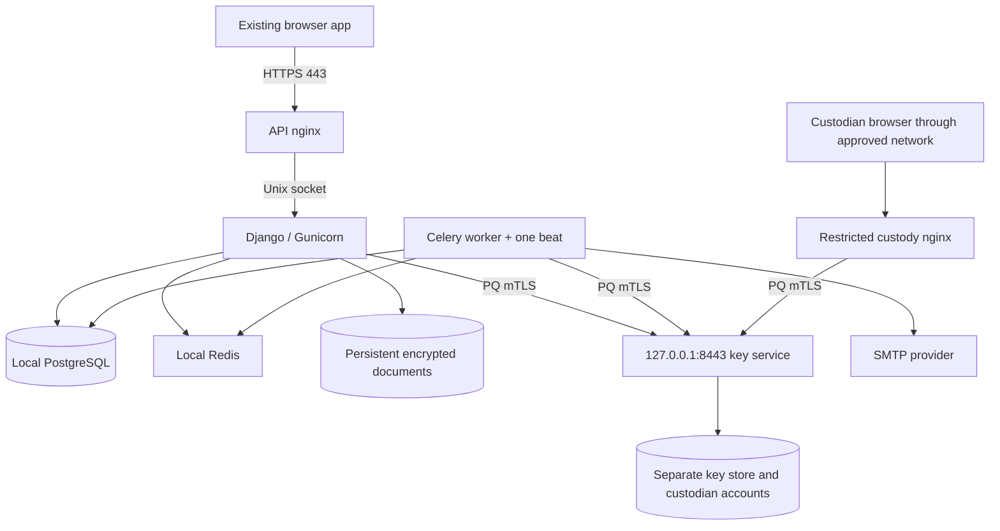

# AWS-only deployment guide — OneSmarter Secure Mail

> Audit storage decision — 2026-11-04: staff/admin activity logs remain in the same
> application PostgreSQL database on EC2. External audit archival code is removed; no audit bucket or second automatic
> audit copy is required. Earlier mandatory S3/Object Lock audit requirements are
> superseded. Database logs are not immutable against privileged administrators.
> Key-service security journals, recovery snapshots and cryptographic release
> gates remain separate and unchanged. See [DATABASE_AUDIT.md](DATABASE_AUDIT.md).


**Installation sequence:** use [AWS_FROM_SCRATCH.md](AWS_FROM_SCRATCH.md) for the current native AWS commands. The detailed sections below are reference material; do not mix their historical paths with the current procedure.

**Current account model:** all four Secure Mail processes use `ubuntu`. PostgreSQL, Redis and nginx retain their system accounts. Existing installations must follow [the single-user migration](SINGLE_USER_DEPLOYMENT.md). This supersedes earlier separate-OS-user claims; key-service paths remain unchanged and custodian unseal stays manual.


Current EC2 startup: [one-command startup and installation guide](ONE_COMMAND_AWS_STARTUP.md). The native units now use `/var/www/securemail-backend/current` and `/var/www/securemail-backend/venv`; `onesmarter.target` starts the stack while custodian unseal remains manual. This guide supersedes older executable paths and individual startup commands below.


Updated: 4 November 2026. Repository: `OneSmarterInc/securemail-backend`.

This guide covers **one Ubuntu EC2 instance**, native systemd services, no Docker.
It includes Django, PostgreSQL, Redis, Celery, private key service and the custody
page. It does not include Vercel installation or frontend deployment. The existing
frontend's exact HTTPS origin is needed only for backend URL/CORS/CSRF settings.

Production startup is now supported with configuration validation. The key service
starts sealed. Independent cryptographic review, deployed PQ evidence and restore
approval are still outstanding. The experimental MAC/checkpoint candidate remains
synthetic-only. The legacy checkpoint protects an anchored prefix, not every later
row against coherent rewriting. See PRODUCTION_STARTUP.md for that limitation.

**Execution rule:** run one command at a time, inspect its result, and stop on an
error. Commands containing REPLACE placeholders require your actual values first.
These instructions do not claim any AWS resources have already been deployed.

## 1. Prepare AWS and identify prerequisites

1. Select the approved AWS region. Launch an Ubuntu EC2 instance with a supported
   CPU architecture for your runtime artifacts. Record instance ID and region.
2. Attach persistent storage sized for permanently retained documents, databases
   and growth. Disable deletion on termination for data volumes that must survive.
   Mount and verify storage before creating the application directories below.
   This guide does not format disks or overwrite an existing database.
3. Use a stable public ingress address. Point the API DNS name
   `securemailbackend.onesmarter.com` at it. Confirm `custody.onesmarter.com` before
   creating its record/certificate. Do not create public DNS for `keys.internal`.
4. Permit inbound TCP 443 for the API. Permit SSH 22 only from your administrator
   IP/network, or use your configured Session Manager access. Do not open 8443,
   5432 or 6379. Restrict custody access additionally by VPN/operator IP in nginx;
   a port-443 security group cannot distinguish the two HTTPS hostnames.
5. Attach a least-privilege EC2 instance role for the configured audit archive.
   Do not put AWS access keys in the source or frontend. Provision the archive's
   retention and access controls separately before filling AUDIT_BUCKET.
6. Have a verified native PQ Python/OpenSSL runtime and PQ-capable nginx build
   available. The repository's deploy/Dockerfile.pq records the tested runtime
   dependencies; it is a reference here, not an instruction to run Docker.
   **This repository does not supply a complete native runtime installer or a
   ready-to-install custody nginx configuration.** Resolve these prerequisites
   before attempting a public deployment; do not weaken TLS to get past them.

AWS references: [security-group rules](https://docs.aws.amazon.com/AWSEC2/latest/UserGuide/security-group-rules-reference.html)
and [preserving EBS volumes](https://docs.aws.amazon.com/AWSEC2/latest/UserGuide/preserving-volumes-on-termination.html).

Connect from your workstation, replacing both placeholders:

```bash
ssh -i /path/to/your-ec2-key.pem ubuntu@REPLACE_WITH_EC2_ADDRESS
```

All later Linux commands run in that EC2 shell unless labelled off-host.
Have your image administrator install approved Git, PostgreSQL, Redis, OpenSSL,
nginx and runtime packages. Stock nginx/Python packages must not be assumed to
meet the PQ requirement. Avoid building a compiler/runtime on a tiny instance.

## 2. Understand the service connections



All server components above run on this EC2 under distinct identities. The
custody HTML/JS ships with the backend; it needs no second React deployment.
Same-host root compromise can affect both application and key service. Separate
Linux users do not provide HSM or separate-host isolation. Recovery secrets and
verified backups must remain off-host.

## 3. Prepare service identities and persistent directories

**PREPARE — application host:** run these only if the account/directories do not
already exist. The data filesystem must already be mounted; this guide never
formats a volume.

```bash
```

```bash
sudo install -d -o root -g ubuntu -m 0750 /etc/onesmarter
```

```bash
sudo install -d -o ubuntu -g ubuntu -m 0700 /var/lib/onesmarter/runtime
```

The existing API systemd template uses a group-accessible Unix socket. Grant the
approved nginx worker group access and restart nginx after changing group
membership. Do not grant it access to the key host's credential directories.

**PREPARE — key host:**

```bash
```

Shared executable source is installed once using the one-command startup guide.

The current policy CLI writes atomically as the key-service identity. Give that
authorized identity a private configuration directory for this procedure:

```bash
sudo install -d -o ubuntu -g ubuntu -m 0700 /etc/onesmarter-key
```

```bash
sudo install -d -o ubuntu -g ubuntu -m 0700 /var/lib/onesmarter-key /var/lib/onesmarter-key/accounts
```

Use persistent EBS storage with deletion on termination disabled where required.
Mount availability must be a service dependency. A backup on the same instance
does not protect against instance loss. AWS-managed EBS encryption uses KMS;
the no-KMS project decision therefore requires an explicitly approved OS/disk
encryption and recovery design. Do not silently enable KMS or claim application
file encryption protects every OS/database field.

## 4. Install the backend release and runtime

Follow steps 3–5 in [ONE_COMMAND_AWS_STARTUP.md](ONE_COMMAND_AWS_STARTUP.md)
for the immutable source export, shared root-owned venv and native stack installer.
The actual paths are `/var/www/securemail-backend/current`,
`/var/www/securemail-backend/releases` and `/var/www/securemail-backend/venv`.
Both service identities read the same source/runtime; their data and secrets stay
separate. No second source checkout or `/opt/onesmarter` installation is required.

Your built OpenSSL is `/var/www/onesmarter-openssl/bin/openssl`. Verify Python uses
the required runtime rather than relying on the standalone openssl version:

```bash
cd /var/www/securemail-backend/current
/var/www/securemail-backend/venv/bin/python -c 'import ssl; from backend.transport.tls import configure; print(ssl.OPENSSL_VERSION); configure(ssl.SSLContext(ssl.PROTOCOL_TLS_CLIENT), required=True)'
```

Failure is a stop condition, not a reason to enable classical escape flags.
Nginx must independently use a verified PQ-capable OpenSSL build.

## 5. Configure PostgreSQL and Redis

**Confirmed choice: PostgreSQL on the same EC2 as the application.** No RDS
endpoint is used. Existing Django code supports this; no schema change is needed.
The AWS environment template already selects localhost PostgreSQL.

### Local listener and authentication

Find the actual cluster configuration paths:

```bash
sudo -u postgres psql -Atc "SHOW config_file;"
sudo -u postgres psql -Atc "SHOW hba_file;"
sudo -u postgres psql -Atc "SHOW data_directory;"
```

Edit the returned postgresql.conf path using sudoedit:

```conf
listen_addresses = '127.0.0.1'
port = 5432
password_encryption = 'scram-sha-256'
```

Preserve local administrator peer access in pg_hba.conf. Add this application
rule before broader matching host rules; do not use trust authentication:

```conf
host    secure_mail    secure_mail_app    127.0.0.1/32    scram-sha-256
```

Use `pg_lsclusters` and `systemctl list-units 'postgresql*'` to identify the actual
Ubuntu cluster service. Restart that service after reviewing the changes, before
creating the password below. A restart interrupts existing connections: schedule
it if the database already serves traffic. Existing non-SCRAM passwords need an
interactive reset after changing password_encryption.

References: [listener settings](https://www.postgresql.org/docs/current/runtime-config-connection.html),
[SCRAM authentication](https://www.postgresql.org/docs/17/auth-password.html).


**PREPARE:** install approved PostgreSQL and Redis distributions. PostgreSQL 17
is the existing CI/deployment baseline. Package repository setup is platform
specific; use your approved Ubuntu image/package policy.

For a new local PostgreSQL instance, create an application role without superuser,
role-creation or database-creation privileges:

```bash
sudo -u postgres createuser --pwprompt --no-superuser --no-createdb --no-createrole secure_mail_app
```

```bash
sudo -u postgres createdb --owner=secure_mail_app secure_mail
```

These commands prompt for the database password instead of putting it in command
arguments. Keep that password in the backend environment's secret channel.
Review `pg_hba.conf` for SCRAM authentication and restricted hosts. Review Redis
binding, protected mode, ACLs and persistence. Never expose either database to
the Internet. Separate private services need explicit transport configuration
and review; the present settings template does not claim all DB/Redis hops are PQ.

### Backend configuration and connection checks

Set these in `/etc/onesmarter/backend.env`:

```dotenv
POSTGRES_HOST=127.0.0.1
POSTGRES_PORT=5432
POSTGRES_DB=secure_mail
POSTGRES_USER=secure_mail_app
POSTGRES_PASSWORD=REPLACE_WITH_THE_PASSWORD_CHOSEN_ABOVE
```

Replace the placeholder privately; never commit the filled environment file.
Verify with a prompted password:

```bash
psql -h 127.0.0.1 -p 5432 -U secure_mail_app -d secure_mail -W -c "SELECT current_database(), current_user;"
sudo ss -ltnp 'sport = :5432'
```

Expect secure_mail / secure_mail_app and a loopback-only listener. Do not open
5432 in the EC2 security group. After loading the complete environment in step 8,
check Django with its configured interpreter and management launcher:

```bash
python manage.py shell -c "from django.db import connection; connection.ensure_connection(); print(connection.vendor)"
```

Expected output: postgresql. Production startup rejects SQLite. Keep the actual
PostgreSQL data_directory on persistent storage and include database backups in
the off-host restore plan. Loopback/SCRAM is not proof of PQ transport or protection
against host-root compromise.

## 6. Resolve the private key-service name locally

Inspect the current entry, then edit it without duplicating the hostname:

```bash
grep -n 'keys.internal' /etc/hosts
sudoedit /etc/hosts
```

Set exactly one mapping:

```text
127.0.0.1 keys.internal
```

Verify:

```bash
getent ahostsv4 keys.internal
```

Every returned address must be 127.0.0.1. No Route 53 private zone is needed.
Do not enable systemd PrivateNetwork: all local services must share host loopback.

## 7. Install certificates and establish file ownership

There are two certificate categories:

| Certificate | Example name / purpose | Issuer |
|---|---|---|
| API browser certificate | `securemailbackend.onesmarter.com` | Browser-trusted certificate authority |
| Maintenance browser certificate | `custody.onesmarter.com` | Browser-trusted authority, or an explicitly managed browser trust policy |
| Key-service server certificate | SAN `DNS:keys.internal`, server authentication | Approved private PKI |
| Workload client certificate | API/worker key operations | Approved private PKI, client authentication |
| Maintenance client certificate | Offline organization-key rotation | Approved private PKI, client authentication |
| Custodian gateway client certificate | Gateway to custody endpoints | Approved private PKI, client authentication |

Generate private keys on their destination hosts, submit CSRs to your approved
issuer, and install returned certificates/chains. Do not distribute a CA private
key onto runtime hosts. Certificate identity algorithms, lifetimes, revocation
and renewal are part of the crypto/PQ review; hybrid key agreement alone does not
make classical certificate signatures post-quantum.

Inspect an issued certificate without displaying its private key:

```bash
openssl x509 -in /etc/onesmarter-key/pki/server.pem -noout -subject -issuer -dates -ext subjectAltName
```

The server name must match the URL, and client certificates need the appropriate
extended key usage. A certificate signed by the CA is not sufficient: the service
also requires an exact fingerprint entry in its policy. Reissuing a certificate
changes the fingerprint and requires deliberate policy renewal.


| Item | Example location | Who needs it? |
|---|---|---|
| Backend source | `/var/www/securemail-backend/current` | API/worker read-only |
| Backend environment | `/etc/onesmarter/backend.env` | API/worker operator and service identity |
| Documents/runtime | `/var/lib/onesmarter/runtime` | API/worker |
| Key-service source | `/var/www/securemail-backend/current` | Key-service identity read-only |
| Key-service environment | `/etc/onesmarter-key/service.env` | Key-service identity/operator |
| Key store | `/var/lib/onesmarter-key/store.sqlite3` | Key-service identity |
| Custodian accounts | `/var/lib/onesmarter-key/accounts/` | Same key-service identity |
| Certificate policy | `/etc/onesmarter-key/policy.json` | Read by service; changed by authorized operator |
| Server TLS material | `/etc/onesmarter-key/pki/` | Key-service identity |
| Workload client TLS material | `/etc/onesmarter/pki/` | API/worker identity |
| Gateway client TLS material | `/etc/onesmarter-gateway/pki/` | Restricted gateway identity |
| Recovery/unseal secret | Off-host custody storage | Authorized custodians |
| Private CA signing key | Separate PKI/custody system | Certificate issuer only |

The recovery secret, root key, TLS private key and custodian password are **not
interchangeable**. Copying the same secret into several configuration fields is
incorrect. Do not share the application's workload certificate with the gateway.

The custodian credential key must be available while document keys are sealed so
people can authenticate. On Linux this software-custody key is a restricted local
file. It is not an HSM and is not protected by the document unseal secret. Its
backup, host compromise and rollback risks still require review.

## 8. Create protected environments and the management launcher

### Backend environment — application host

Copy `deploy/aws.env.example` to `/etc/onesmarter/backend.env` through an authorized
operator. Set restrictive ownership/mode and fill secrets through the approved
secret channel. Key settings:

```dotenv
APP_ENV=production
DJANGO_READ_DOT_ENV=false
PUBLIC_URL=https://securemail.onesmarter.com
RECIPIENT_PUBLIC_URL=https://securemail.onesmarter.com/recipient
ALLOWED_HOSTS=securemailbackend.onesmarter.com
CORS_ALLOWED_ORIGINS=https://securemail.onesmarter.com
CSRF_TRUSTED_ORIGINS=https://securemail.onesmarter.com
COOKIE_SAMESITE=Lax
TRUSTED_PROXY_UNIX_SOCKET=true
ENABLE_DEV_TOOLS=false
KEY_PROTECTOR=key-service
KEY_SERVICE_URL=https://keys.internal:8443
KEY_SERVICE_CA=/etc/onesmarter/pki/key-service-ca.pem
KEY_SERVICE_CERT=/etc/onesmarter/pki/workload.pem
KEY_SERVICE_KEY=/etc/onesmarter/pki/workload.key
KEY_SERVICE_REQUIRE_PQ=true
PQ_TRANSPORT_REQUIRED=true
ALLOW_LEGACY_SYNTHETIC_READS=false
APP_RUNTIME_DIR=/var/lib/onesmarter/runtime
STORAGE_PROVIDER=local
POSTGRES_HOST=127.0.0.1
POSTGRES_PORT=5432
POSTGRES_DB=secure_mail
POSTGRES_USER=secure_mail_app
REDIS_URL=redis://127.0.0.1:6379/0
MAIL_PROVIDER=smtp
EMAIL_HOST=REPLACE_WITH_APPROVED_PROVIDER_HOST
EMAIL_PORT=587
EMAIL_HOST_USER=REPLACE_WITH_AUTHORIZED_MAILBOX
DEFAULT_FROM_EMAIL=REPLACE_WITH_AUTHORIZED_FROM_ADDRESS
```

Also supply the secret fields from the example: `DJANGO_SECRET_KEY`,
`DOCUMENT_INTEGRITY_KEY`, `SEARCH_INDEX_KEY`, `POSTGRES_PASSWORD` and
`EMAIL_HOST_PASSWORD`, plus the approved audit/backup settings. They must be
stable across restarts. The code uses SMTP STARTTLS; no antivirus variables exist.
`PUBLIC_URL` is the frontend origin, with no `/staff` suffix. Replace every proposed
frontend origin consistently if the final name differs.

### Key-service environment — key host

The eventual approved service environment includes:

```dotenv
APP_ENV=production
KEY_SERVICE_CUSTODIAN_DIRECTORY=/var/lib/onesmarter-key/accounts
```

Its startup arguments separately specify the store, backup directory, policy,
server certificate/key, client CA, bind address, port and expected browser Origin.
Do not put the unseal secret in this environment. Do not reuse the app workload's
SMTP/database secrets for the runtime key-service process.

The current `manage.py custodian` command still loads Django settings. A separate
operator-only management environment must satisfy those settings, and production
requires the complete production configuration. Do not assume `service.env` alone is sufficient for it or
copy every application secret onto the key host without reviewing that dependency.
Decoupling/approving this bootstrap dependency is part of production readiness.

### Loading environment files

systemd `EnvironmentFile=` loads its file for the service. An SSH shell does not
inherit that file. `DJANGO_READ_DOT_ENV=false` also prevents automatic `.env` loading.
Never print a filled environment file to diagnostic logs.

For an operator-managed, dotenv-compatible file, this complete invocation pattern
loads it without evaluating it as shell code. **AFTER APPROVAL**, on the correct
host, adjust the three paths and final management command:

```bash
sudo -u ubuntu /var/www/securemail-backend/venv/bin/python - /etc/onesmarter/backend.env /var/www/securemail-backend/current migrate --plan <<'PY'
import os
import sys
from pathlib import Path
from dotenv import load_dotenv

environment, checkout, *arguments = sys.argv[1:]
if not load_dotenv(environment, override=True, interpolate=False):
    raise SystemExit("Environment file is empty or unavailable")
os.environ["DJANGO_READ_DOT_ENV"] = "false"
os.chdir(checkout)
os.execv(sys.executable, [sys.executable, str(Path(checkout) / "manage.py"), *arguments])
PY
```

This does not bypass Django's production configuration checks. Use simple reviewed dotenv syntax
compatible with your service launcher; an arbitrary shell script is not an env file.
Interactive password commands need a terminal: the loader above execs Python after
reading its script, and getpass uses the controlling terminal when available. Use
an authorized interactive session for bootstrap/password prompts, not CI logs.


Use root ownership and group read permission for `/etc/onesmarter/backend.env`
(mode 0640, group onesmarter). Create it from deploy/aws.env.example without
replacing an existing filled file. Fill AWS_REGION, AUDIT_BUCKET and a positive
AUDIT_RETENTION_DAYS; production validation rejects missing archive settings.
Generate separate random values for DJANGO_SECRET_KEY, DOCUMENT_INTEGRITY_KEY
and SEARCH_INDEX_KEY; each must be at least 32 characters. Keep all three stable.

The runtime service.env contains APP_ENV=production, SYNTHETIC_MODE=false and
KEY_SERVICE_CUSTODIAN_DIRECTORY=/var/lib/onesmarter-key/accounts. It contains no
unseal secret. Restrict it to its service account. The management environment for
custodian CLI must be provisioned separately and must satisfy Django settings;
do not grant the key-service process access to the application environment.

## 9. Migrate and create the first application administrator

With the application environment loaded using the preceding launcher, run:

```bash
python manage.py check --deploy
python manage.py migrate --plan
python manage.py migrate --noinput
python manage.py bootstrap_admin --email REPLACE_WITH_ADMIN_EMAIL --name "Workspace administrator"
python manage.py key_status
```

Use `/var/www/securemail-backend/venv/bin/python`, the `/var/www/securemail-backend/current` checkout and
OS identity onesmarter. The bare commands above denote arguments to the launcher,
not a shell that automatically loads backend.env. Inspect all deployment warnings.
Record the organization UUID from key_status for certificate policy registration.
Bootstrap creates the staff admin, not a custodian. The key service can still be
sealed/offline at this metadata stage. Do not provision organization keys yet.

## 10. Generate the off-host unseal secret and initialize once

**PREPARE — trusted operator computer, not the EC2 shell:** generate the secret
only when you have an approved custody location and initialization plan.

```powershell
python -c "import base64,secrets; print(base64.b64encode(secrets.token_bytes(32)).decode('ascii'))"
```

The output is canonical Base64 for 32 random bytes, matching the application's
decoder. Store it privately off-host. Do not paste it into chat, a ticket, a
shell argument, GitHub or the frontend environment. A normal password is not a
substitute for these random bytes.

**On EC2, as the key-service identity:**

```bash
cd /var/www/securemail-backend/current
sudo -u ubuntu env APP_ENV=production /var/www/securemail-backend/venv/bin/python -m backend.keyservice init --store /var/lib/onesmarter-key/store.sqlite3
```

It prompts, with input hidden:

```text
Secret generated and retained in off-host custody (base64, 32 bytes):
Confirm off-host secret:
```

The operator enters the independently stored secret twice. Successful completion
prints `Initialized sealed store. Keep recovery custody independent of this host.`
It refuses to overwrite a store. Do not delete an existing store to retry.

This initializes the currently supported legacy store. It does not enable the
experimental audit candidate. Production startup support does not constitute
independent approval of this audit design.

The unseal secret unlocks the root; it is not a user's password. Each document has
a separate DEK, and organization wrapping-key versions are provisioned separately
after the store is ready. Creating the store alone does not make document sending
ready.

## 11. Export and independently preserve the first checkpoint

Export the initial checkpoint while you control the newly initialized store:

```bash
sudo -u ubuntu env APP_ENV=production \
  /var/www/securemail-backend/venv/bin/python -m backend.keyservice checkpoint \
  --store /var/lib/onesmarter-key/store.sqlite3 \
  --destination /var/lib/onesmarter-key/initial-checkpoint.json
sudo install -d -o root -g ubuntu -m 0750 /etc/onesmarter-trust
sudo install -o root -g ubuntu -m 0640 \
  /var/lib/onesmarter-key/initial-checkpoint.json \
  /etc/onesmarter-trust/checkpoint.json
```

Independently retain and verify this checkpoint off-host, together with the
corresponding store backup. The local protected copy alone does not survive a
root compromise. The staging export is not the trust source on later starts.
Never accept an arbitrary existing store's newly exported checkpoint as proof
that its history was authentic. Existing stores need a verified existing anchor.

## 12. Register the gateway, workload and rotation certificates

**AFTER the approved initialization/PKI plan:** run these as the authorized policy
operator on the key host. Copy only public client certificates there for
registration; the client private keys stay on their respective hosts.

Custody gateway registration, using current CLI syntax:

```bash
sudo -u ubuntu /var/www/securemail-backend/venv/bin/python -m backend.keyservice identity --policy /etc/onesmarter-key/policy.json --cert /etc/onesmarter-key/pki/gateway-client.pem --name custody-gateway --role custodian --days 30
```

Workload registration, after determining the real organization UUID:

```bash
sudo -u ubuntu /var/www/securemail-backend/venv/bin/python -m backend.keyservice identity --policy /etc/onesmarter-key/policy.json --cert /etc/onesmarter-key/pki/workload-client.pem --name application-workload --role workload --organization REPLACE_WITH_ORGANIZATION_UUID --days 30
```

Register a distinct rotation identity:

```bash
sudo -u ubuntu /var/www/securemail-backend/venv/bin/python -m backend.keyservice identity --policy /etc/onesmarter-key/policy.json --cert /etc/onesmarter-key/pki/rotation-client.pem --name offline-key-maintenance --role maintenance --organization REPLACE_WITH_ORGANIZATION_UUID --days 30
```

The policy directory must permit the authorized identity command's atomic writes.
Do not run concurrent policy writers. The sample 30-day authorization is not
automatic renewal. Monitor policy and certificate expiry separately. Avoid an
organization wildcard: use the actual UUID. The `custodian` machine role here
authorizes the gateway, **not a human login account**.

## 13. Create the first named custodian

**AFTER APPROVAL**, under the key-service OS identity with the approved management
environment loaded, run:

```bash
cd /var/www/securemail-backend/current
/var/www/securemail-backend/venv/bin/python manage.py custodian create --username ammar --name "Ammar Aziz" --policy /etc/onesmarter-key/policy.json
```

The shared directory must be set to
`KEY_SERVICE_CUSTODIAN_DIRECTORY=/var/lib/onesmarter-key/accounts` for both this
command and the service. Otherwise the CLI defaults to `custodians` beside the
policy, and you may create an account in the wrong store.

The command prints a private setup-file path, not its contents. The file contains
the temporary setup code. Deliver it privately; remove the handoff file after
successful handoff according to your custody procedure. The code expires after
24 hours or when setup finishes.

First login sequence:

1. Open `https://custody.onesmarter.com/maintenance/` through approved private access.
2. Enter `ammar` and the temporary setup code.
3. Choose and confirm a new password, 16–256 characters, different from the code.
4. Enroll the QR/manual secret in the authenticator and submit a fresh TOTP.
5. Password and TOTP setup must both complete before maintenance access is granted.
6. The temporary code stops working. Future logins use password plus TOTP.
7. Enter the independently held unseal secret in the unseal form.

Additional custodian:

```bash
python manage.py custodian create --username second-custodian --name "Second Custodian" --policy /etc/onesmarter-key/policy.json
```

Administration commands, under the same identity/environment:

```bash
python manage.py custodian list --policy /etc/onesmarter-key/policy.json
python manage.py custodian deactivate --username ammar --policy /etc/onesmarter-key/policy.json
python manage.py custodian activate --username ammar --policy /etc/onesmarter-key/policy.json
python manage.py custodian reset-totp --username ammar --policy /etc/onesmarter-key/policy.json
python manage.py custodian reset-setup --username ammar --policy /etc/onesmarter-key/policy.json
```

Run only the intended action, not this whole list. Deactivation/resets revoke
sessions. `reset-totp` keeps the password; `reset-setup` issues a new setup code
and requires a new password and TOTP enrollment. Each person has attributable
events. Multiple accounts do not imply M-of-N unseal or separate per-person root
secrets. That custody design remains open.

## 14. Install and start the sealed key service

Review the supplied unit's paths, certificate names and expected custody origin.
It must bind 127.0.0.1, not an EC2 interface. From the installed backend checkout:

```bash
sudo install -m 0644 deploy/onesmarter-keyservice.service /etc/systemd/system/onesmarter-keyservice.service
sudo systemctl daemon-reload
sudo systemctl enable --now onesmarter-keyservice
sudo systemctl status onesmarter-keyservice --no-pager
sudo ss -ltnp 'sport = :8443'
```

Expected listener: ONLY `127.0.0.1:8443`. Expected state: sealed. No
`--synthetic-only` flag is used in production. Missing/corrupt trusted checkpoints
or incompatible PQ runtimes must prevent startup. Do not disable those checks.

## 15. Configure API nginx and the restricted maintenance gateway

The gateway must serve only the maintenance interface, not all key-service URLs.
The browser sends HTTPS to `custody.onesmarter.com`; nginx connects to
`keys.internal:8443` using its scoped client certificate and verifies the server.

Required mapping:

| Browser path | Private service path |
|---|---|
| `/maintenance/` | `/` |
| `/maintenance/portal.js` | `/portal.js` |
| `/maintenance/portal.css` | `/portal.css` |
| `/maintenance/custodian-qr.js` | `/custodian-qr.js` |
| `/maintenance/login` | `/login` |
| `/maintenance/v1/custody-status` | `/v1/custody-status` |
| `/maintenance/v1/custody-audit` | `/v1/custody-audit` |
| `/maintenance/v1/unseal` | `/v1/unseal` |
| `/maintenance/v1/seal` | `/v1/seal` |
| `/maintenance/v1/rotate-root` | `/v1/rotate-root` |
| `/maintenance/v1/logout` | `/v1/logout` |

Do not expose `/v1/wrap`, `/v1/unwrap`, `/v1/import` or an unrestricted `/v1/`
proxy. Candidate restore is a separate approved capability, not enabled by this
table. Reject unknown routes/query variations and enforce intended HTTP methods.

The reviewed nginx configuration must provide:

- Browser TLS 1.3/PQ policy and private network access restrictions.
- Upstream `proxy_ssl_verify on`, trusted server CA, name `keys.internal`, SNI,
  gateway client certificate/private key and TLS 1.3 with the approved hybrid group.
- No upstream session reuse where the transport policy forbids resumption.
- Exact route allowlist, request-size/time limits, no request/body/token logging,
  no caching and no mutation retries against another upstream.
- Preserve the actual browser `Origin`; the service's expected origin is
  `https://custody.onesmarter.com`, without `/maintenance/`.
- Rewrite cookie path `/` to `/maintenance/`. Preserve Secure, HttpOnly and
  SameSite attributes. Do not broaden the cookie domain.
- Serve script/style paths consistently with the mapping above.

This is a required configuration contract, not a claim that a production gateway
has been deployed or verified. The ordinary API nginx example is **not** a custody
gateway. Nginx supports upstream certificate verification, client certificates
and OpenSSL configuration commands, but validate the exact build and negotiated
group rather than assuming a directive proves PQ transport.
[Nginx upstream TLS documentation](https://nginx.org/en/docs/http/ngx_http_proxy_module.html#proxy_ssl_conf_command)


For the API, adapt `deploy/aws-api.nginx.conf.example` with real certificates.
Include it from nginx's http context; use your installed nginx layout. Ensure
its worker can traverse /run/onesmarter and connect to app.sock through the
onesmarter group, without granting access to key-service data. Review that group
membership also permits reading any other group-readable app files.

After reviewing both gateway configurations:

```bash
sudo nginx -t
sudo systemctl reload nginx
```

Do not proxy arbitrary `/v1/` paths. Do not publicly expose the key-service port.
The provided API policy is hybrid-only; unsupported browsers will fail TLS.

## 16. Unseal and provision the first organization key

1. Open the restricted custody URL.
2. Use the temporary setup code, choose a password and enroll TOTP on first login.
3. Sign in, enter the separately stored recovery secret, and unseal.
4. Run the following command with the full application management environment,
   but KEY_SERVICE_CERT/KEY pointing to the separate maintenance client identity:

```bash
python manage.py rotate_wrapping_key --organization REPLACE_WITH_ORGANIZATION_UUID --reason "Initial organization key provisioning" --request-id REPLACE_WITH_FIXED_OPERATION_UUID --expected-active none
```

Generate the operation UUID once; reuse it unchanged on retries. Restore workload
credentials for ordinary API/worker operation. Rotation requires a healthy backup
path. A successful login alone does not initialize organization encryption keys.

## 17. Start API, worker and one scheduler

From `/var/www/securemail-backend/current`, install the native units:

```bash
sudo install -m 0644 deploy/onesmarter-api.service /etc/systemd/system/onesmarter-api.service
sudo install -m 0644 deploy/onesmarter-worker.service /etc/systemd/system/onesmarter-worker.service
sudo install -m 0644 deploy/onesmarter-beat.service /etc/systemd/system/onesmarter-beat.service
sudo systemctl daemon-reload
sudo systemctl enable --now onesmarter-api
sudo systemctl enable --now onesmarter-worker
sudo systemctl enable --now onesmarter-beat
```

Run only one beat process. Starting workers can send eligible queued SMTP mail.
Verify your authorized sender and provider settings before doing so. Account SMTP
credentials and DNS authentication must match the chosen provider. Antivirus is
not installed or required; type, size and quota validation remain.

Inspect service health without printing environment files:

```bash
sudo systemctl status onesmarter-api onesmarter-worker onesmarter-beat --no-pager
sudo journalctl -u onesmarter-api -n 50 --no-pager
sudo journalctl -u onesmarter-keyservice -n 50 --no-pager
sudo ss -ltnp
```

Expected: public HTTPS only, optional restricted SSH; databases and key service
local only. API runs behind its Unix socket. Do not paste secrets or private
logs into support tickets. For a constrained host review LOW_MEMORY_DEPLOYMENT.md;
small-instance operation still needs actual peak-memory/load measurements.

## 18. Verify AWS readiness, restart and recovery

1. PostgreSQL and Redis become available.
2. Key service starts **sealed** with its private listener and custody account store.
3. API and worker connect to dependencies. Sealed/unavailable custody keeps
   document sending disabled; workers defer protected delivery.
4. Custodian visits the gateway and authenticates with password plus TOTP.
5. Custodian supplies the independently stored unseal secret.
6. Key service verifies the store and required checkpoint state. Failure leaves
   it unavailable; an integrity override is not normal document readiness.
7. Application readiness checks pass and authorized document operations resume.

Unsealing keeps usable root/key material in process memory; it does not write the
entered secret into a new `.env` file. Sealing/restarting clears live references.
Software cannot promise physical memory erasure across every OS/runtime condition;
core dumps, swap and privileged host access remain operational concerns.

Logging out of maintenance does not itself mean sealing. Removing or expiring a
visitor session does not delete committed documents. Retention, key recovery and
access authorization are separate lifecycles.


**PREPARE/read-only diagnostics on the intended hosts:**

```bash
getent hosts keys.internal
sudo ss -lntp
sudo systemctl status onesmarter-api onesmarter-worker onesmarter-beat --no-pager
sudo journalctl -u onesmarter-api -n 80 --no-pager
```

Do not paste raw logs into a public ticket; review for sensitive values first.
After approved activation, verify real TLS with the actual PQ Python runtime:

```bash
python scripts/verify_pq_endpoint.py --host securemailbackend.onesmarter.com --port 443 --ca /etc/ssl/certs/ca-certificates.crt
```

From an authorized private host, using its own permitted certificate:

```bash
python scripts/verify_pq_endpoint.py --host keys.internal --port 8443 --ca /etc/onesmarter/pki/key-service-ca.pem --cert /etc/onesmarter/pki/workload.pem --key /etc/onesmarter/pki/workload.key
```

The checker requires hybrid success and classical handshake rejection. An outage
does not count as downgrade rejection. TLS success alone does not prove HTTP
identity scope, end-user authorization or key readiness.

Before real data, verify:

- Staff login/MFA and custodian password/TOTP enrollment independently.
- Exact-origin CORS and rejection of missing CSRF/unapproved origins.
- Sealed service blocks document sending; authorized unseal enables readiness.
- Staff request → recipient email/OTP → validated upload → encrypted storage →
  submission on same thread → authorized staff read.
- File size/type limits and staged-byte quotas; no claim of malware scanning.
- Thread/documents survive session expiry; unauthorized users cannot read them.
- Distinct custodian identities appear in searchable/sortable activity records.
- Wrong unseal secret, revoked certificate, expired policy and outage fail safely.
- SMTP authentication and delivery using approved synthetic recipients only.
- Backup restore, root rotation, external checkpoint availability and pagination/
  concurrency behavior on the deployed configuration.

This AWS verification does not prove transport protection at the separately hosted
frontend. Browser edge, internal connections, certificate authentication, DB/Redis
and SMTP scope require separate evidence; do not claim universal PQ coverage.


Back up these as a coordinated recoverable set:

- PostgreSQL database and application integrity/search/signing secrets.
- Encrypted document/evidence files and their metadata.
- Key-store snapshots, public checkpoint records and pinned receiver identities.
- Custodian account database and its credential key, with appropriate restrictions.
- Certificate policy and recoverable PKI/client identities.
- Off-host recovery secret through a separate custody process.

Checkpoint retention and document/backup retention are distinct policies.
Committed documents have no automatic age-based deletion baseline. Do not prune
old-root snapshots after only a same-host drill. Use the approved off-host copy
and clean-machine restore evidence requirements.

Record paired frontend/backend commit IDs. Take verified backups before schema or
key changes. Run migrations against the intended database only. Code rollback is
not safe database/key rollback by itself. Restore on a clean host and confirm
representative document integrity before accepting recovery as successful.

Monitor disk growth, archive lag, audit integrity, checkpoint receiver failures,
queue backlog, certificate/policy expiry and repeated authentication failures.
Assign alert owners and record RTO/RPO. There is no antivirus service to operate.

## 19. Troubleshooting

| Symptom | Check first |
|---|---|
| `Production configuration invalid` | Supply the named settings; do not change APP_ENV to bypass validation |
| `keys.internal` does not resolve | Check `/etc/hosts` maps to `127.0.0.1` and `hosts:` consults `files` |
| 8443 connection refused | Service status and `127.0.0.1:8443` listener; do not publish the port publicly |
| TLS handshake fails | Actual group support, hostname/SAN, CA chain, client certificate and expiry |
| TLS works but service returns 403 | Fingerprint policy, expiry, role/organization/operation scope |
| Custodian account not found | CLI and service account-directory values/OS identity match |
| First setup expired | Authorized `custodian reset-setup`; do not edit hashes or TOTP counters manually |
| Maintenance page loads but scripts fail | Trailing slash and exact asset path mapping |
| Maintenance login fails after proxying | Origin preservation, secure cookie path, gateway certificate scope |
| Staff login loops | Secure cookies, frontend/API origins, CSRF, SameSite and exact CORS configuration |
| `Service is disabled` | Key service sealed, unavailable, unsupported suite or unverified integrity state |
| Readiness succeeds but first encryption fails | Organization key version and workload scope provisioned |
| Upload rejected | Size/type/quota/authorization checks, not antivirus |
| Email remains queued | Worker/beat/broker, key readiness, SMTP sender authorization and retries |
