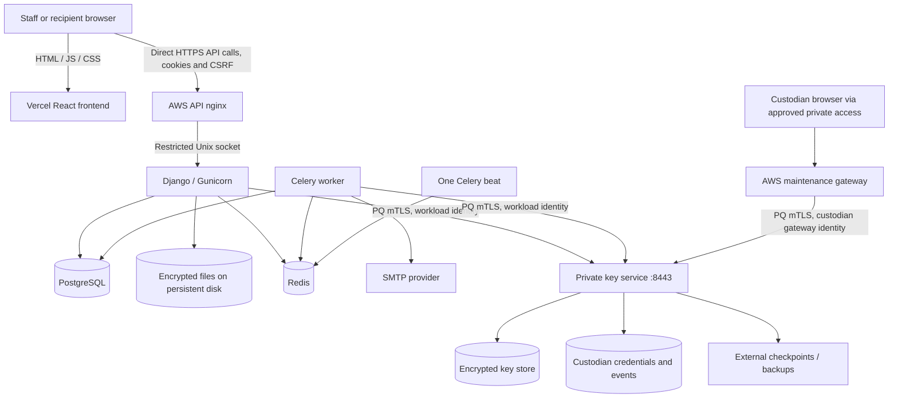

# OneSmarter Secure Mail: complete deployment and first-use guide

Date: 2026-11-04 (Asia/Kolkata). Audience: the owner and deployment operator.

This guide describes native Linux services on AWS and a static React deployment
on Vercel. Docker is not required. Antivirus has been removed from the product,
code and deployment requirements at the owner's request. File-type/size checks
are retained; files are not checked for malware.

Unless a section says Vercel/frontend, repository paths and commands refer to
`securemail-backend`. A copy of this guide is also supplied in the frontend
repository for convenience; backend commands are not run from that checkout.

## 1. Read this before running commands

Production-mode startup is supported with strict configuration checks. See
[Production startup](PRODUCTION_STARTUP.md) for the key-service unit and trusted
checkpoint setup. Independent crypto review and live deployment evidence remain
outstanding. The experimental audit candidate remains synthetic-only.

Commands are labelled:

- **PREPARE:** infrastructure/source preparation that does not start the app with
  real data. Review identifiers, ownership and paths before running.
- **AFTER APPROVAL:** commands whose successful use requires an approved release,
  its complete environment, certificates and reviewed custody configuration.
- **REFERENCE ONLY:** explains the current CLI; it is not a production activation
  recipe or permission to bypass a release gate.

Do not set `APP_ENV=development` on a public server to get past an error.
The supported runtime uses the existing store and a separately protected trusted
checkpoint; it does not promote the experimental audit format. Review the audit
limitations in PRODUCTION_STARTUP.md before accepting real-data use.

No AWS resources, DNS entries, certificates or Vercel projects were provisioned
by writing this document. All example IPs below are illustrative.

## 2. Will there be two frontends?

There are **two browser interfaces, but only one React frontend deployment**.

| Interface | People using it | Code | Hosted where? |
|---|---|---|---|
| Main application | Staff, administrators and document recipients | `securemail-frontend`, React/TypeScript | Vercel |
| Maintenance/custodian page | Authorized named custodians | `backend/keyservice/portal.html`, `portal.js`, `portal.css` and local QR asset | Served by the key service through an AWS HTTPS gateway |

The maintenance page does not need a second Vercel project or a second frontend
repository. Its HTML and JavaScript ship with `securemail-backend`. A portal admin
is not automatically a custodian. Staff password/MFA and custodian password/TOTP
belong to separate account systems.

Opening `/maintenance/` on the Vercel app redirects to the configured maintenance
gateway. The address bar changes. This is the current split-hosting behavior;
keeping the maintenance page on the Vercel origin would require a different,
reviewed proxy arrangement and is not supplied here.

## 3. Every service and its responsibility

| Component | Responsibility | Persistent data | Needs public access? |
|---|---|---|---|
| Vercel | Sends React HTML/JS/CSS to browsers | Source/build artifacts; no document store | Yes |
| API nginx | HTTPS/PQ ingress, request limits, trusted client-IP forwarding | Public-domain TLS key/certificate | HTTPS 443 |
| Django/Gunicorn | Sessions, permissions, conversations, uploads, encryption orchestration | Uses PostgreSQL and encrypted file storage | No direct public listener |
| PostgreSQL | Accounts, conversation metadata, encrypted fields, outbox, audit projections | Database files/backups | No |
| Redis | Celery broker and configured transient coordination | Redis persistence as configured | No |
| Celery worker | Processes queued work, including eligible email | Uses database outbox and configured storage | No |
| Celery beat | Schedules periodic tasks | Scheduler state | No; run exactly one |
| Key service | Holds protected private key versions; authorizes wrap/unwrap/rotation | Encrypted key store and backups | No; private 8443 |
| Custodian credential store | Password hashes, encrypted TOTP seeds, replay counters and account events | Separate account database and credential key | No |
| Custody nginx gateway | Presents maintenance page; forwards only permitted custody routes with mTLS | Scoped gateway certificate/private key | Restricted HTTPS/VPN access |
| External checkpoint/backup destination | Protects against host loss and witnessed rollback | Checkpoints, protected snapshots | Only authorized service/operator paths |
| SMTP provider | Sends authorized notifications/ordinary mail | Provider-specific | Outbound connection from worker |

The key service is not a file server. Documents stay in the backend's persistent
storage; keys are managed separately. The application can receive temporary DEKs
for authorized decryption, so application compromise remains in the threat model.

## 4. Recommended initial machine layout

This is a proposed layout, not a record of provisioned resources:

| Place | Runs there |
|---|---|
| Vercel project | React application only |
| AWS application EC2 host | API nginx, Gunicorn, worker, beat; initially private local PostgreSQL/Redis if that operating model is approved |
| Separate private AWS key EC2 host | Key service and its custodian account store |
| Restricted gateway | May run as a separate nginx service on the application host; separate certificate and permissions |
| Separate administration/backup account or host | Checkpoint receiver and off-host backup copies |

Keeping the key service on a separate host preserves a meaningful OS boundary.
Separate processes on the same host are cheaper but share its compromise/failure
boundary. This guide does not silently choose that weaker arrangement.

PostgreSQL and Redis can move to approved private managed services later. That
requires explicit connection encryption, identity, backup and non-PQ-hop review;
changing a hostname alone is not the complete migration.



## 5. Domains, DNS and ports

| Purpose | Name | Status |
|---|---|---|
| Backend API | `securemailbackend.onesmarter.com` | Supplied by owner |
| Main frontend | `securemail.onesmarter.com` | Proposed; owner must confirm |
| Maintenance | `custody.onesmarter.com` | Proposed; owner must confirm |
| Internal key service | `keys.internal` | Local `/etc/hosts` mapping to key-service private IP |

The API URL is `https://securemailbackend.onesmarter.com`. Browser calls append
`/api/...` or `/recipient-api/...`. Do not add `/api` to `VITE_BACKEND_URL`.

**PREPARE — public DNS:**

1. Import the frontend into Vercel and add the confirmed frontend custom domain.
2. Set the exact DNS records Vercel displays. Do not guess a Vercel IP address.
3. Point the backend domain to the approved AWS ingress address.
4. Configure maintenance DNS according to the private-access design. A public
   DNS record does not mean the service must accept public connections.
5. Issue certificates for the names clients actually visit.

**PREPARE — local hostname mapping (no private DNS service):**

Use each Linux client's `/etc/hosts` file instead of a Route 53 private hosted
zone. No hosted zone, Resolver endpoint, or domain purchase is needed for this
internal name. Public frontend/API DNS is unchanged.

1. In EC2, identify the key-service instance's actual private IPv4 address.
   `10.0.2.20` below is an example only; do not use it unless it is that instance.
2. On the application host (including the Celery worker host) and custody-gateway
   host, inspect existing entries before editing:

   ```bash
   grep -n 'keys.internal' /etc/hosts
   ```

3. Edit with `sudoedit /etc/hosts`. Add or update exactly one mapping, retaining
   unrelated entries. Replace the example IP with the actual key-service IP:

   ```text
   10.0.2.20 keys.internal
   ```

4. Verify on EVERY connecting host:

   ```bash
   getent ahostsv4 keys.internal
   ```

   Every returned address must be the intended key-service private IPv4. Linux
   hostname resolution must consult `files` in `/etc/nsswitch.conf`'s `hosts:`
   entry. Use `getent`, not `dig` or `nslookup`, to test `/etc/hosts` resolution.

Keep `KEY_SERVICE_URL=https://keys.internal:8443` and certificate SAN
`DNS:keys.internal`. Keep CA validation, mTLS, SNI and PQ transport checks enabled.
Do not replace the URL with an IP unless a matching IP SAN is deliberately issued.
For the custody proxy, retain `proxy_ssl_name keys.internal`, SNI and certificate
verification. Validate `nginx -t` and reload nginx after a mapping change; restart
application and worker services during a maintenance window to clear old pooled
connections. Validate the actual mTLS endpoint using the transport check below.

This mapping is local to each machine. Containers do not inherit the host's
`/etc/hosts`; if containerized, set `extra_hosts`/`--add-host` for every connecting
API, worker and gateway container using the same actual private IP. Do not mount
the entire host `/etc/hosts` into containers. The native systemd deployment in
this guide uses the host mapping directly.

Keep the key host's private IP stable. If the instance/private IP is replaced,
update every mapping and repeat transport verification. This manual maintenance
is the tradeoff for avoiding private DNS. Clients still need private network
routing and the security-group rules below. Public browsers connect only to the
portal, never directly to `keys.internal`.

These are preparation instructions; no EC2 host mapping was changed locally.

Firewall/security-group targets:

| Destination | Port | Allowed source |
|---|---|---|
| API ingress | TCP 443 | Approved public client access |
| Maintenance ingress | TCP 443 | Approved VPN/operator network |
| Key EC2 | TCP 8443 | Application and custody-gateway security groups only |
| PostgreSQL | TCP 5432 | Application host only, or local loopback |
| Redis | TCP 6379 | Application processes only, or local loopback |
| SSH | TCP 22 | Approved admin network, or use SSM instead |

Gunicorn uses `/run/onesmarter/app.sock`, not a public TCP port. Never allow
`0.0.0.0/0` to 8443, 5432 or 6379. Direct EC2 ingress is assumed; adding an ALB,
CloudFront or other proxy changes TLS/PQ and client-IP trust boundaries.

## 6. Files, secrets and who owns them

| Item | Example location | Who needs it? |
|---|---|---|
| Backend source | `/opt/onesmarter/current` | API/worker read-only |
| Backend environment | `/etc/onesmarter/backend.env` | API/worker operator and service identity |
| Documents/runtime | `/var/lib/onesmarter/runtime` | API/worker |
| Key-service source | `/opt/onesmarter-key/current` | Key-service identity read-only |
| Key-service environment | `/etc/onesmarter-key/service.env` | Key-service identity/operator |
| Key store | `/var/lib/onesmarter-key/store.sqlite3` | Key-service identity |
| Custodian accounts | `/var/lib/onesmarter-key/accounts/` | Same key-service identity |
| Certificate policy | `/etc/onesmarter-key/policy.json` | Read by service; changed by authorized operator |
| Server TLS material | `/etc/onesmarter-key/pki/` | Key-service identity |
| Workload client TLS material | `/etc/onesmarter/pki/` | API/worker identity |
| Gateway client TLS material | `/etc/onesmarter-gateway/pki/` | Restricted gateway identity |
| Recovery/unseal secret | Off-host custody storage | Authorized custodians |
| Private CA signing key | Separate PKI/custody system | Certificate issuer only |

The recovery secret, root key, TLS private key and custodian password are **not
interchangeable**. Copying the same secret into several configuration fields is
incorrect. Do not share the application's workload certificate with the gateway.

The custodian credential key must be available while document keys are sealed so
people can authenticate. On Linux this software-custody key is a restricted local
file. It is not an HSM and is not protected by the document unseal secret. Its
backup, host compromise and rollback risks still require review.

## 7. Prepare Linux accounts and persistent storage

**PREPARE — application host:** run these only if the account/directories do not
already exist. The data filesystem must already be mounted; this guide never
formats a volume.

```bash
sudo useradd --system --home /var/lib/onesmarter --shell /usr/sbin/nologin onesmarter
```

```bash
sudo install -d -o root -g onesmarter -m 0750 /opt/onesmarter /opt/onesmarter/releases /etc/onesmarter
```

```bash
sudo install -d -o onesmarter -g onesmarter -m 0700 /var/lib/onesmarter/runtime
```

The existing API systemd template uses a group-accessible Unix socket. Grant the
approved nginx worker group access and restart nginx after changing group
membership. Do not grant it access to the key host's credential directories.

**PREPARE — key host:**

```bash
sudo useradd --system --home /var/lib/onesmarter-key --shell /usr/sbin/nologin onesmarter-key
```

```bash
sudo install -d -o root -g onesmarter-key -m 0750 /opt/onesmarter-key /opt/onesmarter-key/releases
```

The current policy CLI writes atomically as the key-service identity. Give that
authorized identity a private configuration directory for this procedure:

```bash
sudo install -d -o onesmarter-key -g onesmarter-key -m 0700 /etc/onesmarter-key
```

```bash
sudo install -d -o onesmarter-key -g onesmarter-key -m 0700 /var/lib/onesmarter-key /var/lib/onesmarter-key/accounts
```

Use persistent EBS storage with deletion on termination disabled where required.
Mount availability must be a service dependency. A backup on the same instance
does not protect against instance loss. AWS-managed EBS encryption uses KMS;
the no-KMS project decision therefore requires an explicitly approved OS/disk
encryption and recovery design. Do not silently enable KMS or claim application
file encryption protects every OS/database field.

## 8. Install source and runtime

**PREPARE — operator workspace on each applicable host:**

```bash
git clone https://github.com/OneSmarterInc/securemail-backend.git
```

```bash
cd securemail-backend
git switch main
git rev-parse HEAD
```

Record and review the exact commit. Deploy that immutable snapshot into a new
release directory; do not update a running checkout with unreviewed `git pull`.
Use `/opt/onesmarter/current` and `/opt/onesmarter-key/current` as release pointers
under the operator's control. Do not overwrite an existing pointer accidentally.

The repository's ordinary tests use Python 3.12. Required PQ transport needs a
Python/OpenSSL combination actually exposing the required TLS APIs and
`X25519MLKEM768`; the locally exercised candidate uses Python 3.15/OpenSSL ≥3.5.
An Ubuntu package version or `openssl version` alone does not prove Python uses
that same library. A reviewed native runtime installation is a prerequisite;
this guide does not invent an apt package that provides it.

After installing that runtime at an operator-approved path, create each venv
using that interpreter. Example assumed interpreter path:

```bash
/opt/onesmarter-runtime/bin/python3 -m venv /opt/onesmarter/venv
```

On the key host use `/opt/onesmarter-key/venv` instead. Install locked artifacts:

```bash
/opt/onesmarter/venv/bin/python -m pip install --require-hashes --only-binary=:all: -r /opt/onesmarter/current/requirements.lock
```

For the key host substitute its venv/source paths. Verify the actual interpreter:

```bash
cd /opt/onesmarter/current
/opt/onesmarter/venv/bin/python -c 'import ssl; from backend.transport.tls import configure; print(ssl.OPENSSL_VERSION); configure(ssl.SSLContext(ssl.PROTOCOL_TLS_CLIENT), required=True)'
```

Failure is a stop condition, not a reason to enable classical escape flags.
The Python packages contain the key service as well as Django. Nginx needs its
own independently verified OpenSSL/PQ capability; the Python venv does not upgrade
nginx automatically.

## 9. PostgreSQL and Redis preparation

**PREPARE:** install approved PostgreSQL and Redis distributions. PostgreSQL 17
is the existing CI/deployment baseline. Package repository setup is platform
specific; use your approved Ubuntu image/package policy.

For a new local PostgreSQL instance, create an application role without superuser,
role-creation or database-creation privileges:

```bash
sudo -u postgres createuser --pwprompt --no-superuser --no-createdb --no-createrole secure_mail_app
```

```bash
sudo -u postgres createdb --owner=secure_mail_app secure_mail
```

These commands prompt for the database password instead of putting it in command
arguments. Keep that password in the backend environment's secret channel.
Review `pg_hba.conf` for SCRAM authentication and restricted hosts. Review Redis
binding, protected mode, ACLs and persistence. Never expose either database to
the Internet. Separate private services need explicit transport configuration
and review; the present settings template does not claim all DB/Redis hops are PQ.

## 10. Certificates and mTLS: what to request

There are two certificate categories:

| Certificate | Example name / purpose | Issuer |
|---|---|---|
| API browser certificate | `securemailbackend.onesmarter.com` | Browser-trusted certificate authority |
| Maintenance browser certificate | `custody.onesmarter.com` | Browser-trusted authority, or an explicitly managed browser trust policy |
| Key-service server certificate | SAN `DNS:keys.internal`, server authentication | Approved private PKI |
| Workload client certificate | API/worker key operations | Approved private PKI, client authentication |
| Maintenance client certificate | Offline organization-key rotation | Approved private PKI, client authentication |
| Custodian gateway client certificate | Gateway to custody endpoints | Approved private PKI, client authentication |

Generate private keys on their destination hosts, submit CSRs to your approved
issuer, and install returned certificates/chains. Do not distribute a CA private
key onto runtime hosts. Certificate identity algorithms, lifetimes, revocation
and renewal are part of the crypto/PQ review; hybrid key agreement alone does not
make classical certificate signatures post-quantum.

Inspect an issued certificate without displaying its private key:

```bash
openssl x509 -in /etc/onesmarter-key/pki/server.pem -noout -subject -issuer -dates -ext subjectAltName
```

The server name must match the URL, and client certificates need the appropriate
extended key usage. A certificate signed by the CA is not sufficient: the service
also requires an exact fingerprint entry in its policy. Reissuing a certificate
changes the fingerprint and requires deliberate policy renewal.

## 11. Create the first unseal secret and key store

**PREPARE — trusted operator computer, not the EC2 shell:** generate the secret
only when you have an approved custody location and initialization plan.

```powershell
python -c "import base64,secrets; print(base64.b64encode(secrets.token_bytes(32)).decode('ascii'))"
```

The output is canonical Base64 for 32 random bytes, matching the application's
decoder. Store it privately off-host. Do not paste it into chat, a ticket, a
shell argument, GitHub or the frontend environment. A normal password is not a
substitute for these random bytes.

**REFERENCE ONLY — current legacy initialization command, on the key host:**

```bash
cd /opt/onesmarter-key/current
sudo -u onesmarter-key /opt/onesmarter-key/venv/bin/python -m backend.keyservice init --store /var/lib/onesmarter-key/store.sqlite3
```

It prompts, with input hidden:

```text
Secret generated and retained in off-host custody (base64, 32 bytes):
Confirm off-host secret:
```

The operator enters the independently stored secret twice. Successful completion
prints `Initialized sealed store. Keep recovery custody independent of this host.`
It refuses to overwrite a store. Do not delete an existing store to retry.

**Stop point:** without the candidate flag this creates the legacy audit format.
Candidate initialization additionally requires the synthetic candidate environment,
an enrollment artifact, separately pinned receiver identity and checkpoint setup.
It is not production-approved. Do not promote either initialization path to real
data until the approved release specifies the final procedure. See
`DESIGN_DECISIONS_2026-11-04.md` and `AUDIT_CANDIDATE.md`.

The unseal secret unlocks the root; it is not a user's password. Each document has
a separate DEK, and organization wrapping-key versions are provisioned separately
after the store is ready. Creating the store alone does not make document sending
ready.

## 12. Register machine identities in policy

**AFTER the approved initialization/PKI plan:** run these as the authorized policy
operator on the key host. Copy only public client certificates there for
registration; the client private keys stay on their respective hosts.

Custody gateway registration, using current CLI syntax:

```bash
sudo -u onesmarter-key /opt/onesmarter-key/venv/bin/python -m backend.keyservice identity --policy /etc/onesmarter-key/policy.json --cert /etc/onesmarter-key/pki/gateway-client.pem --name custody-gateway --role custodian --days 30
```

Workload registration, after determining the real organization UUID:

```bash
sudo -u onesmarter-key /opt/onesmarter-key/venv/bin/python -m backend.keyservice identity --policy /etc/onesmarter-key/policy.json --cert /etc/onesmarter-key/pki/workload-client.pem --name application-workload --role workload --organization REPLACE_WITH_ORGANIZATION_UUID --days 30
```

Register a distinct rotation identity:

```bash
sudo -u onesmarter-key /opt/onesmarter-key/venv/bin/python -m backend.keyservice identity --policy /etc/onesmarter-key/policy.json --cert /etc/onesmarter-key/pki/rotation-client.pem --name offline-key-maintenance --role maintenance --organization REPLACE_WITH_ORGANIZATION_UUID --days 30
```

The policy directory must permit the authorized identity command's atomic writes.
Do not run concurrent policy writers. The sample 30-day authorization is not
automatic renewal. Monitor policy and certificate expiry separately. Avoid an
organization wildcard: use the actual UUID. The `custodian` machine role here
authorizes the gateway, **not a human login account**.

## 13. Environment files and safe management-command execution

### Backend environment — application host

Copy `deploy/aws.env.example` to `/etc/onesmarter/backend.env` through an authorized
operator. Set restrictive ownership/mode and fill secrets through the approved
secret channel. Key settings:

```dotenv
APP_ENV=production
DJANGO_READ_DOT_ENV=false
PUBLIC_URL=https://securemail.onesmarter.com
RECIPIENT_PUBLIC_URL=https://securemail.onesmarter.com/recipient
ALLOWED_HOSTS=securemailbackend.onesmarter.com
CORS_ALLOWED_ORIGINS=https://securemail.onesmarter.com
CSRF_TRUSTED_ORIGINS=https://securemail.onesmarter.com
COOKIE_SAMESITE=Lax
TRUSTED_PROXY_UNIX_SOCKET=true
ENABLE_DEV_TOOLS=false
KEY_PROTECTOR=key-service
KEY_SERVICE_URL=https://keys.internal:8443
KEY_SERVICE_CA=/etc/onesmarter/pki/key-service-ca.pem
KEY_SERVICE_CERT=/etc/onesmarter/pki/workload.pem
KEY_SERVICE_KEY=/etc/onesmarter/pki/workload.key
KEY_SERVICE_REQUIRE_PQ=true
PQ_TRANSPORT_REQUIRED=true
ALLOW_LEGACY_SYNTHETIC_READS=false
APP_RUNTIME_DIR=/var/lib/onesmarter/runtime
STORAGE_PROVIDER=local
POSTGRES_HOST=127.0.0.1
POSTGRES_PORT=5432
POSTGRES_DB=secure_mail
POSTGRES_USER=secure_mail_app
REDIS_URL=redis://127.0.0.1:6379/0
MAIL_PROVIDER=smtp
EMAIL_HOST=REPLACE_WITH_APPROVED_PROVIDER_HOST
EMAIL_PORT=587
EMAIL_HOST_USER=REPLACE_WITH_AUTHORIZED_MAILBOX
DEFAULT_FROM_EMAIL=REPLACE_WITH_AUTHORIZED_FROM_ADDRESS
```

Also supply the secret fields from the example: `DJANGO_SECRET_KEY`,
`DOCUMENT_INTEGRITY_KEY`, `SEARCH_INDEX_KEY`, `POSTGRES_PASSWORD` and
`EMAIL_HOST_PASSWORD`, plus the approved audit/backup settings. They must be
stable across restarts. The code uses SMTP STARTTLS; no antivirus variables exist.
`PUBLIC_URL` is the frontend origin, with no `/staff` suffix. Replace every proposed
frontend origin consistently if the final name differs.

### Key-service environment — key host

The eventual approved service environment includes:

```dotenv
APP_ENV=production
KEY_SERVICE_CUSTODIAN_DIRECTORY=/var/lib/onesmarter-key/accounts
```

Its startup arguments separately specify the store, backup directory, policy,
server certificate/key, client CA, bind address, port and expected browser Origin.
Do not put the unseal secret in this environment. Do not reuse the app workload's
SMTP/database secrets for the runtime key-service process.

The current `manage.py custodian` command still loads Django settings. A separate
operator-only management environment must satisfy those settings, and production
requires the complete production configuration. Do not assume `service.env` alone is sufficient for it or
copy every application secret onto the key host without reviewing that dependency.
Decoupling/approving this bootstrap dependency is part of production readiness.

### Loading environment files

systemd `EnvironmentFile=` loads its file for the service. An SSH shell does not
inherit that file. `DJANGO_READ_DOT_ENV=false` also prevents automatic `.env` loading.
Never print a filled environment file to diagnostic logs.

For an operator-managed, dotenv-compatible file, this complete invocation pattern
loads it without evaluating it as shell code. **AFTER APPROVAL**, on the correct
host, adjust the three paths and final management command:

```bash
sudo -u onesmarter /opt/onesmarter/venv/bin/python - /etc/onesmarter/backend.env /opt/onesmarter/current migrate --plan <<'PY'
import os
import sys
from pathlib import Path
from dotenv import load_dotenv

environment, checkout, *arguments = sys.argv[1:]
if not load_dotenv(environment, override=True, interpolate=False):
    raise SystemExit("Environment file is empty or unavailable")
os.environ["DJANGO_READ_DOT_ENV"] = "false"
os.chdir(checkout)
os.execv(sys.executable, [sys.executable, str(Path(checkout) / "manage.py"), *arguments])
PY
```

This does not bypass Django's production configuration checks. Use simple reviewed dotenv syntax
compatible with your service launcher; an arbitrary shell script is not an env file.
Interactive password commands need a terminal: the loader above execs Python after
reading its script, and getpass uses the controlling terminal when available. Use
an authorized interactive session for bootstrap/password prompts, not CI logs.

## 14. First human custodian

**AFTER APPROVAL**, under the key-service OS identity with the approved management
environment loaded, run:

```bash
cd /opt/onesmarter-key/current
/opt/onesmarter-key/venv/bin/python manage.py custodian create --username ammar --name "Ammar Aziz" --policy /etc/onesmarter-key/policy.json
```

The shared directory must be set to
`KEY_SERVICE_CUSTODIAN_DIRECTORY=/var/lib/onesmarter-key/accounts` for both this
command and the service. Otherwise the CLI defaults to `custodians` beside the
policy, and you may create an account in the wrong store.

The command prints a private setup-file path, not its contents. The file contains
the temporary setup code. Deliver it privately; remove the handoff file after
successful handoff according to your custody procedure. The code expires after
24 hours or when setup finishes.

First login sequence:

1. Open `https://custody.onesmarter.com/maintenance/` through approved private access.
2. Enter `ammar` and the temporary setup code.
3. Choose and confirm a new password, 16–256 characters, different from the code.
4. Enroll the QR/manual secret in the authenticator and submit a fresh TOTP.
5. Password and TOTP setup must both complete before maintenance access is granted.
6. The temporary code stops working. Future logins use password plus TOTP.
7. Enter the independently held unseal secret in the unseal form.

Additional custodian:

```bash
python manage.py custodian create --username second-custodian --name "Second Custodian" --policy /etc/onesmarter-key/policy.json
```

Administration commands, under the same identity/environment:

```bash
python manage.py custodian list --policy /etc/onesmarter-key/policy.json
python manage.py custodian deactivate --username ammar --policy /etc/onesmarter-key/policy.json
python manage.py custodian activate --username ammar --policy /etc/onesmarter-key/policy.json
python manage.py custodian reset-totp --username ammar --policy /etc/onesmarter-key/policy.json
python manage.py custodian reset-setup --username ammar --policy /etc/onesmarter-key/policy.json
```

Run only the intended action, not this whole list. Deactivation/resets revoke
sessions. `reset-totp` keeps the password; `reset-setup` issues a new setup code
and requires a new password and TOTP enrollment. Each person has attributable
events. Multiple accounts do not imply M-of-N unseal or separate per-person root
secrets. That custody design remains open.

## 15. Maintenance gateway linkage

The gateway must serve only the maintenance interface, not all key-service URLs.
The browser sends HTTPS to `custody.onesmarter.com`; nginx connects to
`keys.internal:8443` using its scoped client certificate and verifies the server.

Required mapping:

| Browser path | Private service path |
|---|---|
| `/maintenance/` | `/` |
| `/maintenance/portal.js` | `/portal.js` |
| `/maintenance/portal.css` | `/portal.css` |
| `/maintenance/custodian-qr.js` | `/custodian-qr.js` |
| `/maintenance/login` | `/login` |
| `/maintenance/v1/custody-status` | `/v1/custody-status` |
| `/maintenance/v1/custody-audit` | `/v1/custody-audit` |
| `/maintenance/v1/unseal` | `/v1/unseal` |
| `/maintenance/v1/seal` | `/v1/seal` |
| `/maintenance/v1/rotate-root` | `/v1/rotate-root` |
| `/maintenance/v1/logout` | `/v1/logout` |

Do not expose `/v1/wrap`, `/v1/unwrap`, `/v1/import` or an unrestricted `/v1/`
proxy. Candidate restore is a separate approved capability, not enabled by this
table. Reject unknown routes/query variations and enforce intended HTTP methods.

The reviewed nginx configuration must provide:

- Browser TLS 1.3/PQ policy and private network access restrictions.
- Upstream `proxy_ssl_verify on`, trusted server CA, name `keys.internal`, SNI,
  gateway client certificate/private key and TLS 1.3 with the approved hybrid group.
- No upstream session reuse where the transport policy forbids resumption.
- Exact route allowlist, request-size/time limits, no request/body/token logging,
  no caching and no mutation retries against another upstream.
- Preserve the actual browser `Origin`; the service's expected origin is
  `https://custody.onesmarter.com`, without `/maintenance/`.
- Rewrite cookie path `/` to `/maintenance/`. Preserve Secure, HttpOnly and
  SameSite attributes. Do not broaden the cookie domain.
- Serve script/style paths consistently with the mapping above.

This is a required configuration contract, not a claim that a production gateway
has been deployed or verified. The ordinary API nginx example is **not** a custody
gateway. Nginx supports upstream certificate verification, client certificates
and OpenSSL configuration commands, but validate the exact build and negotiated
group rather than assuming a directive proves PQ transport.
[Nginx upstream TLS documentation](https://nginx.org/en/docs/http/ngx_http_proxy_module.html#proxy_ssl_conf_command)

## 16. Backend startup, first staff admin and first organization key

**AFTER APPROVAL:** use the environment loader or your equivalent approved
launcher to run these management commands on the application host:

```bash
python manage.py check --deploy
python manage.py migrate --plan
python manage.py migrate --noinput
python manage.py bootstrap_admin --email admin@onesmarter.com --name "Workspace administrator"
python manage.py key_status
```

Replace the administrator address with an actual approved company account.
`bootstrap_admin` prompts for the password; it creates the first organization and
staff admin and requires staff MFA. It is not the custodian creation command.
`key_status` prints organization IDs and the application's key-version metadata;
it is not a live remote readiness check.

Use the resulting organization UUID in workload/maintenance certificate policy.
After the key store is unsealed and its approved backup/checkpoint prerequisites
are healthy, provision the organization's first wrapping-key version using the
separate maintenance client certificate in the management process environment:

```bash
python manage.py rotate_wrapping_key --organization REPLACE_WITH_ORGANIZATION_UUID --reason "Initial organization key provisioning" --request-id REPLACE_WITH_FIXED_OPERATION_UUID --expected-active none
```

Generate the operation UUID once with `python -c "import uuid; print(uuid.uuid4())"`
and record it. On retry, reuse the exact UUID, reason and expected-active value;
inspect the result rather than generating another operation. The ordinary API
runtime uses workload credentials, not these rotation credentials.

Install and review the existing native service templates:

```bash
sudo install -m 0644 deploy/onesmarter-api.service /etc/systemd/system/onesmarter-api.service
sudo install -m 0644 deploy/onesmarter-worker.service /etc/systemd/system/onesmarter-worker.service
sudo install -m 0644 deploy/onesmarter-beat.service /etc/systemd/system/onesmarter-beat.service
sudo systemctl daemon-reload
```

Then, only for the approved release:

```bash
sudo systemctl enable --now onesmarter-api
sudo systemctl enable --now onesmarter-worker
sudo systemctl enable --now onesmarter-beat
```

Start only one beat instance. Workers may send eligible queued messages once the
key service becomes ready. The key-service systemd unit must use its own account,
mounts, environment and approved startup command; do not repurpose the Django API
unit. Use deploy/onesmarter-keyservice.service and the initialization/checkpoint
instructions in PRODUCTION_STARTUP.md; do not pass --synthetic-only.

For API nginx adapt `deploy/aws-api.nginx.conf.example`, install public certificate
paths, check the default reject listener and Unix-socket group permissions, then:

```bash
sudo nginx -t
sudo systemctl reload nginx
```

The API example enforces hybrid-only connections, including recipient APIs.
Older browsers may be rejected. No classical fallback is silently added.

## 17. Vercel setup step by step

1. Open the intended Vercel team and import
   `OneSmarterInc/securemail-frontend`.
2. Select `main` as the production branch.
3. Select Vite. Root Directory is `.` — not `frontend`.
4. Use Node 24, install command `npm ci`, build command `npm run build`, output
   directory `dist`.
5. Set the following public environment variables for the target environment:

```dotenv
VITE_BACKEND_URL=https://securemailbackend.onesmarter.com
VITE_MAINTENANCE_URL=https://custody.onesmarter.com/maintenance/
```

6. Leave the maintenance URL empty until that gateway exists; the app then reports
   maintenance is not configured rather than exposing a private service URL.
7. Add the confirmed frontend custom domain and follow Vercel's DNS instructions.
8. Build and test. Rebuild whenever a `VITE_` value changes.
9. Test direct reloads of `/staff` and `/recipient`; `vercel.json` provides SPA
   routing. Test `/maintenance/` redirects to the expected gateway.
10. Keep unapproved previews away from real backend data. If testing a preview,
    allow its exact origin on an isolated synthetic API, then remove that grant.

Do not add SMTP passwords, database passwords, unseal keys, private certificates
or Django secrets to Vercel. `VITE_` values are compiled into public browser code.
The frontend repository's private local `.env` is ignored by Git; `.env.example`
contains public placeholders/configuration only.

The static frontend can build while the backend is unavailable or sealed. A successful
Vercel deployment is not evidence that document sending is operational.
[Vercel Vite deployment documentation](https://vercel.com/docs/frameworks/frontend/vite)

## 18. Why separate domains can still log in

The browser obtains the React app from the frontend domain, then calls AWS
directly. Requests include credentials. The API sets host-only session cookies
and returns a CSRF token that the UI holds in memory and sends on mutations.

`CORS_ALLOWED_ORIGINS` permits the exact frontend origin to read API responses.
`CSRF_TRUSTED_ORIGINS` permits that origin for the independent CSRF check; a valid
token remains required. Neither setting authenticates the user.

HTTPS sibling subdomains under `onesmarter.com` support the intended SameSite=Lax
arrangement. Unrelated domains may require SameSite=None/Secure and can still fail
under third-party-cookie blocking. Use the confirmed same-parent custom domains
instead of weakening CSRF or placing session tokens in localStorage.

The maintenance browser cookie belongs to the custody host; it is separate from
staff and recipient cookies. Vercel never receives the unseal form submission in
this design because the browser navigates to the AWS gateway first.

## 19. Exact readiness sequence after restart

1. PostgreSQL and Redis become available.
2. Key service starts **sealed** with its private listener and custody account store.
3. API and worker connect to dependencies. Sealed/unavailable custody keeps
   document sending disabled; workers defer protected delivery.
4. Custodian visits the gateway and authenticates with password plus TOTP.
5. Custodian supplies the independently stored unseal secret.
6. Key service verifies the store and required checkpoint state. Failure leaves
   it unavailable; an integrity override is not normal document readiness.
7. Application readiness checks pass and authorized document operations resume.

Unsealing keeps usable root/key material in process memory; it does not write the
entered secret into a new `.env` file. Sealing/restarting clears live references.
Software cannot promise physical memory erasure across every OS/runtime condition;
core dumps, swap and privileged host access remain operational concerns.

Logging out of maintenance does not itself mean sealing. Removing or expiring a
visitor session does not delete committed documents. Retention, key recovery and
access authorization are separate lifecycles.

## 20. Verification commands and acceptance checklist

**PREPARE/read-only diagnostics on the intended hosts:**

```bash
getent hosts keys.internal
sudo ss -lntp
sudo systemctl status onesmarter-api onesmarter-worker onesmarter-beat --no-pager
sudo journalctl -u onesmarter-api -n 80 --no-pager
```

Do not paste raw logs into a public ticket; review for sensitive values first.
After approved activation, verify real TLS with the actual PQ Python runtime:

```bash
python scripts/verify_pq_endpoint.py --host securemailbackend.onesmarter.com --port 443 --ca /etc/ssl/certs/ca-certificates.crt
```

From an authorized private host, using its own permitted certificate:

```bash
python scripts/verify_pq_endpoint.py --host keys.internal --port 8443 --ca /etc/onesmarter/pki/key-service-ca.pem --cert /etc/onesmarter/pki/workload.pem --key /etc/onesmarter/pki/workload.key
```

The checker requires hybrid success and classical handshake rejection. An outage
does not count as downgrade rejection. TLS success alone does not prove HTTP
identity scope, end-user authorization or key readiness.

Before real data, verify:

- Staff login/MFA and custodian password/TOTP enrollment independently.
- Exact-origin CORS and rejection of missing CSRF/unapproved origins.
- Sealed service blocks document sending; authorized unseal enables readiness.
- Staff request → recipient email/OTP → validated upload → encrypted storage →
  submission on same thread → authorized staff read.
- File size/type limits and staged-byte quotas; no claim of malware scanning.
- Thread/documents survive session expiry; unauthorized users cannot read them.
- Distinct custodian identities appear in searchable/sortable activity records.
- Wrong unseal secret, revoked certificate, expired policy and outage fail safely.
- SMTP authentication and delivery using approved synthetic recipients only.
- Backup restore, root rotation, external checkpoint availability and pagination/
  concurrency behavior on the deployed configuration.

Vercel's delivery of executable frontend code is part of the browser trust chain.
This repository does not enforce/prove Vercel's negotiated PQ behavior. Browser
edge, internal connections, certificate authentication, DB/Redis and SMTP scope
must be explicitly covered by the release review; do not claim universal PQ.

## 21. Backups, updates and recovery

Back up these as a coordinated recoverable set:

- PostgreSQL database and application integrity/search/signing secrets.
- Encrypted document/evidence files and their metadata.
- Key-store snapshots, public checkpoint records and pinned receiver identities.
- Custodian account database and its credential key, with appropriate restrictions.
- Certificate policy and recoverable PKI/client identities.
- Off-host recovery secret through a separate custody process.

Checkpoint retention and document/backup retention are distinct policies.
Committed documents have no automatic age-based deletion baseline. Do not prune
old-root snapshots after only a same-host drill. Use the approved off-host copy
and clean-machine restore evidence requirements.

Record paired frontend/backend commit IDs. Take verified backups before schema or
key changes. Run migrations against the intended database only. Code rollback is
not safe database/key rollback by itself. Restore on a clean host and confirm
representative document integrity before accepting recovery as successful.

Monitor disk growth, archive lag, audit integrity, checkpoint receiver failures,
queue backlog, certificate/policy expiry and repeated authentication failures.
Assign alert owners and record RTO/RPO. There is no antivirus service to operate.

## 22. Troubleshooting

| Symptom | Check first |
|---|---|
| `Production configuration invalid` | Supply the named settings; do not change APP_ENV to bypass validation |
| `keys.internal` does not resolve | Check `/etc/hosts` on the connecting host/container, `hosts: files` resolution, and the actual key-host IP |
| 8443 connection refused | Service status and private bind address; do not publish the port publicly |
| TLS handshake fails | Actual group support, hostname/SAN, CA chain, client certificate and expiry |
| TLS works but service returns 403 | Fingerprint policy, expiry, role/organization/operation scope |
| Custodian account not found | CLI and service account-directory values/OS identity match |
| First setup expired | Authorized `custodian reset-setup`; do not edit hashes or TOTP counters manually |
| Maintenance page loads but scripts fail | Trailing slash and exact asset path mapping |
| Maintenance login fails after proxying | Origin preservation, secure cookie path, gateway certificate scope |
| Staff login loops | Secure cookies, frontend/API origins, CSRF, SameSite and exact CORS configuration |
| `Service is disabled` | Key service sealed, unavailable, unsupported suite or unverified integrity state |
| Readiness succeeds but first encryption fails | Organization key version and workload scope provisioned |
| Upload rejected | Size/type/quota/authorization checks, not antivirus |
| Email remains queued | Worker/beat/broker, key readiness, SMTP sender authorization and retries |
| New frontend env value has no effect | Trigger a rebuild; Vite values are build-time |

## 23. What remains before this becomes a production runbook

This guide supplies the service map, linkage, configuration and current CLI
syntax. The following cannot honestly be replaced with guessed commands:

1. Independent crypto review and approved real-data release; runtime startup checks now validate configuration.
2. Approved audit/checkpoint receiver, enrollment, migration and initialization procedure.
3. Final native PQ runtime/nginx packages, PKI issuance/renewal and verified gateway config.
4. Resolved custodian management bootstrap dependency on Django settings.
5. Confirmed frontend/maintenance domains, region and actual AWS resources.
6. Custody model, recovery ownership, backup target and clean-machine drill.
7. Deployed browser/API/PQ, SMTP, load, alerting and operational evidence.

For the shorter checklist see `DEPLOYMENT_GUIDE.md`; for exact candidate limitations
see `RELEASE_GATES.md`, `AUDIT_CANDIDATE.md` and `CUSTODIAN_ACCOUNTS.md`. Existing
test results are local or CI evidence, not proof of these infrastructure steps.
Django's deployment checklist is also applicable:
[official deployment checklist](https://docs.djangoproject.com/en/5.2/howto/deployment/checklist/).
