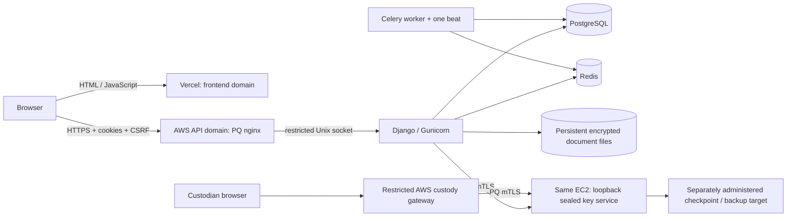

# AWS backend + Vercel frontend deployment

**Installation sequence:** use [AWS_FROM_SCRATCH.md](AWS_FROM_SCRATCH.md) for the current native AWS commands. The detailed sections below are reference material; do not mix their historical paths with the current procedure.

**Current account model:** all four Secure Mail processes use `onesmarter`. PostgreSQL, Redis and nginx retain their system accounts. Existing installations must follow [the single-user migration](SINGLE_USER_DEPLOYMENT.md). This supersedes earlier separate-OS-user claims; key-service paths remain unchanged and custodian unseal stays manual.


Current EC2 startup: [one-command startup and installation guide](ONE_COMMAND_AWS_STARTUP.md). The native units now use `/var/www/securemail-backend/current` and `/var/www/securemail-backend/venv`; `onesmarter.target` starts the stack while custodian unseal remains manual. This guide supersedes older executable paths and individual startup commands below.


Read the [complete service-by-service deployment and first-use guide](COMPLETE_DEPLOYMENT_GUIDE.md) for the frontend/maintenance distinction, private key service, first custodian, configuration and startup sequence.

Prepared 2026-11-04. Antivirus is removed from requirements and code at the owner's request; uploaded documents are not malware-scanned. This is a deployment preparation guide, not a release approval.

**Runtime status:** production startup is supported with strict validation. Follow
[Production startup](PRODUCTION_STARTUP.md). Independent crypto review, deployed
PQ evidence, recovery and custody gates remain open. Configuration acceptance is
not security approval; the experimental audit candidate remains synthetic-only.

## 1. Domains and architecture

| Purpose | Value | Status |
|---|---|---|
| API on AWS | `https://securemailbackend.onesmarter.com` | Owner supplied |
| React app on Vercel | `https://securemail.onesmarter.com` | Proposed; confirm before DNS |
| Custody gateway on AWS/private access | `https://custody.onesmarter.com` | Proposed; confirm before DNS |
| Key service | `https://keys.internal:8443` | Same EC2; `keys.internal` maps to `127.0.0.1` |



Vercel serves static assets. API calls, uploads and downloads go directly from the
browser to AWS; Vercel does not proxy confidential document bodies. Never put
database, SMTP, signing, recovery or mTLS secrets into the frontend environment.

For the selected single-EC2 native deployment, map `keys.internal` to `127.0.0.1`
in `/etc/hosts`. App, worker and custody gateway use the same host loopback. No Route 53 private zone is
required. Keep the hostname in the HTTPS URL and server certificate; do not
disable certificate verification. See COMPLETE_DEPLOYMENT_GUIDE.md for mapping,
container and IP-change instructions.

The split repositories are:

- `OneSmarterInc/securemail-frontend`: React source, npm lockfile, Vercel config.
- `OneSmarterInc/securemail-backend`: Django, workers, key service, file-validation code,
  migrations, tests, native service templates and security/operations documents.

Older documents copied from the monorepo may refer to `frontend/`, Compose or a
combined edge. This guide supersedes their **repository layout and hosting**
instructions only. Their security gates and cryptographic limitations still apply.
The custodian UI is backend-owned; its checked-in QR bundle is reproducible with
`cd tools/custodian-qr && npm ci && npm run build`.

## 2. Frontend environment and Vercel

Import the frontend repository into the intended Vercel team. Select branch
`main`, Framework Vite, Root Directory `.` (not `frontend`), Node 24, Install
Command `npm ci`, Build Command `npm run build`, Output Directory `dist`.

For local development copy `.env.example` to `.env`. For Vercel set these in
Project Settings → Environment Variables for the intended environment:

```dotenv
VITE_BACKEND_URL=https://securemailbackend.onesmarter.com
VITE_MAINTENANCE_URL=https://custody.onesmarter.com/maintenance/
```

The backend URL is an origin: no `/api`, credentials, query string or fragment.
Leave the maintenance URL empty until that protected gateway exists. On Vercel,
`/maintenance/` redirects there; it does not open the private key-service port.
`API_TARGET=http://127.0.0.1:8000` is local Vite proxy configuration only.

All `VITE_` values become public JavaScript. Changing them requires a new build.
The build adds a content security policy whose API connect origin comes from
`VITE_BACKEND_URL`; do not add broad `https:` or wildcard connect permissions.
The committed `vercel.json` adds SPA routing and security/no-store headers.

Add the confirmed frontend custom domain in Vercel and use the exact DNS records
shown by Vercel. Wait for certificate issuance, then test direct reloads of
`/staff` and `/recipient` and ensure JavaScript assets load with correct MIME types.
Do not treat a successful static build as backend readiness or release approval.
Do not connect preview builds to production data: use a separate synthetic API,
explicitly allow each approved preview origin, and remove it afterward.

## 3. AWS network and storage preparation

Choose and record region, budget, owners and retention before real-data use.
Use Ubuntu on EC2 with a stable address/DNS for direct API ingress. Provision
private PostgreSQL and Redis, an isolated key-service identity/host, and a
separately administered backup/checkpoint destination. No AWS resources have
been created by this repository publication.

Security groups/firewall:

- Public API: HTTPS 443 only. Port 80 is optional for certificate validation or
  redirect, never an application endpoint. Prefer DNS certificate validation.
- SSH: restrict to an administrator network or use approved SSM access.
- Do not expose Gunicorn, PostgreSQL 5432, Redis 6379 or key-service
  8443 publicly. The custody gateway is a distinct restricted entry point.
- Restrict egress to approved SMTP, package update, backup and service
  destinations. Document any cloud load balancer before inserting one: TLS
  termination and trusted-client-IP extraction must be reverified.

Use a dedicated persistent EBS filesystem mounted at `/var/lib/onesmarter`.
Disable deletion on instance termination; make services require the mount.
Committed documents remain until an approved exceptional disposal procedure;
visitor session/grant expiration does not delete them. Monitor growth and capacity.
EBS-managed encryption uses KMS: the existing no-KMS decision requires an approved
OS/disk encryption approach and recovery plan, not silent default KMS enablement.
Application encryption does not protect every plaintext database/OS field.
Never publish the data directory as nginx static content.

## 4. Install native services (no Docker required)

Create a dedicated OS account and directories. The following assumes the data
filesystem is already mounted and verified; do not format an existing volume:

```sh
sudo useradd --system --home /var/lib/onesmarter --shell /usr/sbin/nologin onesmarter
sudo install -d -o root -g onesmarter -m 0750 /opt/onesmarter /etc/onesmarter
sudo install -d -o onesmarter -g onesmarter -m 0700 /var/lib/onesmarter/runtime
sudo usermod -a -G onesmarter www-data
```

Deploy an immutable backend checkout to `/opt/onesmarter/releases/<commit>` and
point `/opt/onesmarter/current` at it. Keep code read-only to the service user.
Install a reviewed Python runtime and a virtual environment at
`/opt/onesmarter/venv`. Python 3.12 is the ordinary test baseline; the PQ service
requires a runtime exposing `X25519MLKEM768` backed by OpenSSL ≥3.5 (the repository
also contains the candidate Python 3.15 runtime definition). Ubuntu's default
nginx/Python TLS stack must not be assumed to support the required group.

```sh
/opt/onesmarter/venv/bin/python -m pip install --require-hashes --only-binary=:all: -r /opt/onesmarter/current/requirements.lock
cd /opt/onesmarter/current
/opt/onesmarter/venv/bin/python -c 'import ssl; from backend.transport.tls import configure; configure(ssl.SSLContext(ssl.PROTOCOL_TLS_CLIENT), required=True)'
```

The second command must pass on the actual runtime. Install PostgreSQL 17,
Redis using reviewed packages or private managed services. For a
local database use loopback/Unix transport, dedicated database/user and SCRAM
authentication; never use a database superuser for the app. Remote DB/Redis TLS
and non-PQ residuals require explicit review; this template does not claim to
solve those links. Uploads have no antivirus integration. File-type and size validation are not malware detection.

## 5. Backend environment

Copy `deploy/aws.env.example` to `/etc/onesmarter/backend.env`, fill placeholders
through your authorized secret-management channel, and restrict it to root and
the service group (`0640`). Do not commit the filled file. systemd reads it as an
EnvironmentFile; do not `source` an untrusted environment file as shell code.

The important domain settings are:

```dotenv
APP_ENV=production
DJANGO_READ_DOT_ENV=false
PUBLIC_URL=https://securemail.onesmarter.com
RECIPIENT_PUBLIC_URL=https://securemail.onesmarter.com/recipient
ALLOWED_HOSTS=securemailbackend.onesmarter.com
CORS_ALLOWED_ORIGINS=https://securemail.onesmarter.com
CSRF_TRUSTED_ORIGINS=https://securemail.onesmarter.com
COOKIE_SAMESITE=Lax
TRUSTED_PROXY_UNIX_SOCKET=true
```

`PUBLIC_URL` has no `/staff` suffix: application link builders append routes.
Update every frontend-origin setting if the proposed frontend domain changes.
CORS and CSRF are separate checks; neither accepts `*`. Cookies stay host-only
on the API domain, HttpOnly for sessions, and Secure in non-synthetic mode.
The browser uses credentialed requests and keeps the API-provided CSRF token in
memory. Staff and recipient sessions still use separate cookie names/paths.

Sibling HTTPS subdomains are recommended. Unrelated sites require
`COOKIE_SAMESITE=None` (which forces Secure cookies), but browsers can still block
third-party cookies. Do not work around this by persisting bearer tokens in
localStorage or disabling CSRF. Use same-parent custom domains instead.

Supply stable independently generated `DJANGO_SECRET_KEY`,
`DOCUMENT_INTEGRITY_KEY`, `SEARCH_INDEX_KEY`, database password, approved SMTP
credentials and service certificate paths. Preserve them through upgrades and
backups; do not regenerate at every restart. SMTP uses STARTTLS on 587 with a
provider-authorized sender; verify SPF/DKIM/DMARC for the selected sending domain.
Workers may deliver pending messages once custody is ready.

## 6. Key service and custodian login

Follow `KEY_SERVICE_OPERATIONS.md`, `CUSTODIAN_ACCOUNTS.md` and
`AUDIT_CANDIDATE.md`. Prepare the private PKI and separate workload/status/gateway
identities; authorize exact certificate fingerprints and operations in policy.
Initialize keys once, with off-host recovery custody; never place recovery secrets
beside the live key store or in the frontend environment. Production runtime accepts the legacy store with an independently protected
checkpoint; the experimental candidate remains restricted pending review.

Custodian CLI commands (run on the authorized key-service administration host,
under its OS identity and configured Django environment):

```sh
python manage.py custodian create --username ammar --name "Ammar Aziz" --policy /etc/onesmarter/keyservice-policy.json
python manage.py custodian list --policy /etc/onesmarter/keyservice-policy.json
```

The CLI writes private temporary setup instructions. On first login the custodian
chooses a password and enrolls TOTP before access. The service starts sealed;
document sending remains disabled until readiness succeeds. Stopping/restarting
the service clears its in-memory unsealed keys.

The custody gateway must enforce the existing exact route allowlist, verified
upstream PQ mTLS, scoped gateway certificate, no request-body logging, no caching,
CSRF and an exact configured browser Origin. Use a private network/VPN restriction
as an additional layer. Do not route it through a public generic Vercel rewrite.
Configure its HTTPS origin in key-service `--origin`. The browser path
`/maintenance/` is stripped only by that gateway, with cookie paths rewritten to
`/maintenance/`. Do not expose workload `/v1/wrap` or private admin routes there.
A reviewed, environment-specific gateway/PKI installation is still an operator
prerequisite; this guide does not manufacture production certificates.


## 7. API HTTPS and processes

Provision a certificate for `securemailbackend.onesmarter.com`, then adapt
`deploy/aws-api.nginx.conf.example` with actual certificate paths. Configure a
default reject listener in nginx and ensure no other public listener bypasses
the PQ restriction. This profile uses hybrid-only TLS for both API paths and
therefore rejects browsers lacking that group. Any recipient classical fallback
is a separate documented risk decision, not an implicit deployment convenience.

The proxy overwrites forwarded IP/proto headers and sends traffic over a restricted
Unix socket. It streams uploads without writing plaintext proxy temporary files.
Do not open Gunicorn on 0.0.0.0. Run `nginx -t` with the actual compiled nginx,
then verify the real endpoint with `scripts/verify_pq_endpoint.py --help` and its
documented arguments. Vercel's delivery of JavaScript is also in the browser trust
chain: this repository does not prove/enforce Vercel PQ negotiation. That coverage
must be measured and approved before claiming every hop is PQ protected.

After release approval, load the environment through the approved service launcher
and perform a coordinated backup, then run:

```sh
python manage.py check --deploy
python manage.py migrate --plan
python manage.py migrate --noinput
python manage.py bootstrap_admin --email admin@onesmarter.com
```

These commands validate the complete production environment. Fix missing settings
rather than changing APP_ENV. The bootstrap command prompts for a password and enforces first
staff MFA enrollment. It is distinct from creating a custodian account.

Copy `deploy/onesmarter-{api,worker,beat}.service` to systemd, review paths and
permissions, then `systemctl daemon-reload`. After the approved release is ready,
start API and nginx, then worker and exactly one beat scheduler. The provided
service files use no Docker. The key service has a separate identity, environment
and startup procedure from `KEY_SERVICE_OPERATIONS.md`.

## 8. Verification before real data

1. Check TLS certificate, DNS, SNI, hybrid handshake and rejection of classical
   connections on every required internal hop. Verify 8000/8443/5432/6379
   are unreachable from the Internet.
2. From the frontend domain, request `/api/auth/session` on the API domain.
   Confirm exact CORS Origin, host-only Secure cookies and a CSRF token. A POST
   without CSRF or from an unapproved Origin must fail.
3. Complete staff login/MFA, custodian first-password/TOTP setup and authorized
   unseal. Confirm sealed/unready state blocks document sending and SMTP work.
4. Use synthetic documents for staff request → recipient OTP → upload → validate →
   submit → staff read. Confirm session expiry preserves the same thread/data.
5. Confirm per-user IP throttling behind nginx, no public upload filesystem,
   no confidential response caching and no tokens/content in access logs.
6. Test worker retry/idempotency, SMTP sender authentication and delivery with
   approved test recipients; never use real queues for automated test fixtures.
7. Restore DB, documents, keys, policy and PKI together onto a clean host from
   off-host backups. Record RTO/RPO and digest comparisons. Do custodian drills.
8. Configure paging for custody integrity failures, archive lag, repeated login failures, queue backlog, disk growth and service restarts.

Run the repository suites and record exact commit IDs, CI URLs and environment.
SQLite/PQ local tests, GitHub CI, independent review and deployment tests are
different evidence. A successful `health` endpoint is not a release approval.

## 9. Upgrades and rollback

Record the paired frontend/backend commit IDs. Require CI and review before
deployment. Deploy backward-compatible backend changes before the matching UI.
Take coordinated backups before migrations/key changes; rehearse restores.
Stage Vercel builds with the correct environment and verify before assigning the
custom domain. Rolling code back does not roll migrations or key state back
safely. Preserve old keys until the approved recovery/retirement checks pass.

## Sources and evidence boundary

- [Vercel Vite deployment and SPA routing](https://vercel.com/docs/frameworks/frontend/vite)
- [Vite public build-time environment variables](https://vite.dev/guide/env-and-mode)
- [Django security and cookie settings](https://docs.djangoproject.com/en/5.2/ref/settings/)
- [EC2 security groups](https://docs.aws.amazon.com/AWSEC2/latest/UserGuide/ec2-security-groups.html)

No AWS/Vercel deployment, external crypto approval or real-domain handshake was
performed by preparing and publishing these repositories.

Single-server setup: follow [the ordered backend and frontend steps](SINGLE_EC2_DEPLOYMENT.md).
